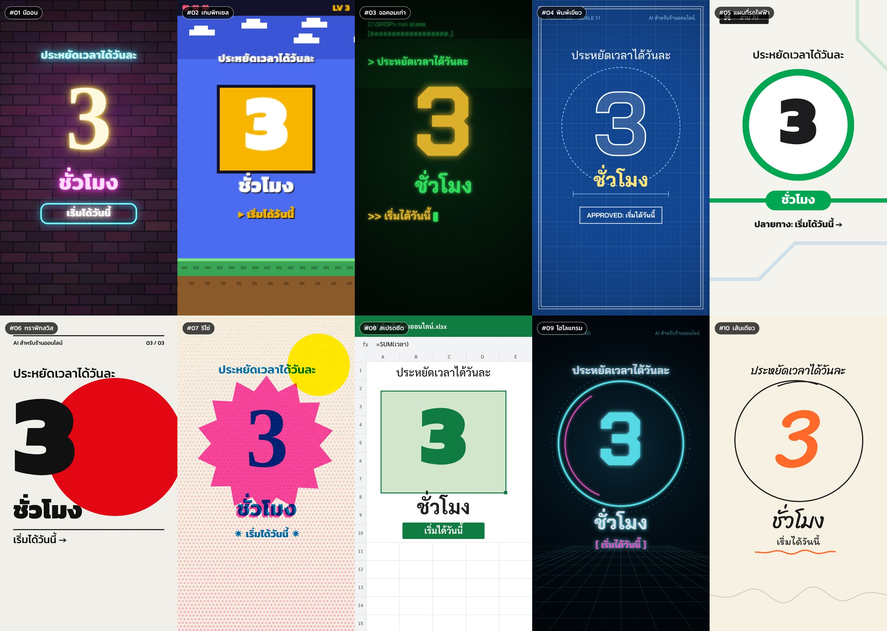

# Thai Motion Clips · บอกหัวข้อ ได้คลิป 50 สไตล์

ระบบทำคลิปโมชั่นกราฟิกแนวตั้ง (1080x1920 สำหรับ TikTok, Reels, Shorts) เป็นภาษาไทย
แค่บอกหัวข้อกับ Claude Code แล้วระบบจะ **เขียนบท → เลือกสไตล์ → ทำเสียงพากย์ → เรนเดอร์คลิป** ให้เอง



- มี 50 สไตล์ (นีออน, เกมพิกเซล, แดชบอร์ด, กระดานชอล์ก, ป้ายเซล, ฯลฯ) ดูทั้งหมดในโฟลเดอร์ [`catalog/`](catalog/)
- ทุกอย่างวาดด้วยโค้ด ไม่ต้องใช้ AI สร้างภาพหรือวิดีโอ จึงไม่เสียค่าเรนเดอร์
- มีซับไตเติ้ล เพลง และเสียงเอฟเฟกต์ให้ในตัว (เพลงสร้างด้วยโค้ด ไม่ติดลิขสิทธิ์)
- เสียงพากย์คุณภาพสูง (ElevenLabs v3) ผ่าน **key OpenRouter ของตัวเองอันเดียว** หรือใช้เสียงฟรี / อัดเสียงเองก็ได้
- คลิป 1 ตัวยาวประมาณ 12–20 วินาที มี 3 ฉาก: ฮุก → รายการ 3 ข้อ → ตัวเลขเด่น + ปิดท้าย

---

## สิ่งที่ต้องมี

| สิ่งที่ต้องมี | ไว้ทำอะไร |
|---|---|
| เครื่อง Mac (Windows ใช้ได้ผ่าน WSL ดูท้ายหน้า) | เครื่องที่ใช้ทำคลิป |
| [Claude Code](https://claude.com/claude-code) (ต้องมีแพ็กเกจ Claude Pro ขึ้นไป) | ตัวที่รับหัวข้อแล้วสั่งทำคลิปให้ |
| Node.js 20+, ffmpeg 7+, Python 3.11+ | ติดตั้งในขั้นที่ 1 |
| Google Chrome | ใช้วาดภาพแต่ละเฟรม (ถ้าไม่มี setup จะโหลดตัวเล็กให้เอง) |

---

## ขั้นที่ 1 · ติดตั้งโปรแกรมพื้นฐาน (ทำครั้งเดียว)

เปิดแอป **Terminal** (กด `Cmd + Space` พิมพ์ Terminal แล้วกด Enter) แล้วคัดลอกทีละบรรทัดไปวาง กด Enter

1. ติดตั้ง Homebrew (ตัวช่วยลงโปรแกรมบน Mac) ข้ามได้ถ้ามีแล้ว
   ```bash
   /bin/bash -c "$(curl -fsSL https://raw.githubusercontent.com/Homebrew/install/HEAD/install.sh)"
   ```
   ถ้าจบแล้วมีข้อความให้รันคำสั่ง `echo ... >> ~/.zprofile` ให้คัดลอกคำสั่งนั้นไปรันด้วย
2. ติดตั้ง Node.js, ffmpeg, Python, git
   ```bash
   brew install node ffmpeg python git
   ```
3. ติดตั้ง Claude Code
   ```bash
   npm install -g @anthropic-ai/claude-code
   ```

## ขั้นที่ 2 · ดาวน์โหลด repo นี้

```bash
cd ~/Documents
git clone <ลิงก์ของ repo นี้>
cd thai-motion-clips
```
(หรือกดปุ่มสีเขียว **Code → Download ZIP** บนหน้า GitHub แล้วแตกไฟล์ไว้ใน Documents จากนั้น `cd ~/Documents/thai-motion-clips`)

## ขั้นที่ 3 · ติดตั้งระบบ

```bash
sh setup.sh
```
รอจนขึ้น `✓ ติดตั้งเสร็จ` (ครั้งแรกใช้เวลา 2–5 นาที) ถ้ามีข้อ ✗ ให้ทำตามที่บอกแล้วรันใหม่ได้เลย รันซ้ำไม่พัง

## ขั้นที่ 4 · ลองทำคลิปตัวอย่าง

```bash
sh clip.sh examples/ai-online-shop 25
```
ได้ไฟล์ `examples/ai-online-shop/ai-online-shop-25.mp4` เปิดดูได้เลย
ลองเปลี่ยนเลข `25` เป็นเลขอื่น 01–50 เพื่อดูสไตล์อื่นจากบทเดิม

## ขั้นที่ 5 · บอกหัวข้อ ให้ Claude ทำคลิป ⭐

ในโฟลเดอร์ repo พิมพ์
```bash
claude
```
แล้วพิมพ์คุยภาษาไทยได้เลย เช่น

> ทำคลิปเรื่อง 3 วิธีเพิ่มยอดขายร้านกาแฟ

> ทำคลิปหัวข้อ ทำไมต้องออมเงินก่อนใช้ สไตล์ 19

> ทำคลิปเรื่องประโยชน์ของการนอนเร็ว ขอ 3 สไตล์ให้เลือก

Claude จะเขียนบท ตรวจภาพตัวอย่าง ทำเสียง และเรนเดอร์ให้ ไฟล์ทั้งหมดอยู่ในโฟลเดอร์ `my-clips/`
ถ้าไม่ชอบตรงไหนก็บอกต่อได้ เช่น "ฮุกแรงกว่านี้", "เปลี่ยนเป็นสไตล์นีออน", "เปลี่ยนคำปิดท้ายเป็น ทักแชตเลย"

---

## ใส่ key OpenRouter (อันเดียวจบ)

ระบบใช้ key ของ [OpenRouter](https://openrouter.ai) อันเดียวสำหรับทำเสียงพากย์ (เสียง ElevenLabs v3 ภาษาไทย ประมาณ 1–2 บาทต่อคลิป)

1. สมัครที่ [openrouter.ai](https://openrouter.ai) แล้วเติมเครดิตที่ [Settings → Credits](https://openrouter.ai/settings/credits) (เริ่มที่ 5 ดอลลาร์ก็ทำได้หลายร้อยคลิป)
2. ไปที่ [Settings → API Keys](https://openrouter.ai/settings/keys) กด **Create Key** แล้วคัดลอก (ขึ้นต้นด้วย `sk-or-`)
3. เปิดไฟล์ `.env` ในโฟลเดอร์ repo (setup สร้างให้แล้ว ถ้าไม่เห็นใน Finder ให้กด `Cmd + Shift + .` เพื่อโชว์ไฟล์ซ่อน) หรือพิมพ์ `open -e .env`
4. วาง key หลัง `OPENROUTER_API_KEY=` แล้วเซฟ จบ

> ⚠️ ไฟล์ `.env` คือรหัสส่วนตัว ห้ามส่งให้ใคร ห้ามอัปขึ้น GitHub (repo นี้ตั้งให้ไม่อัปไฟล์นี้อยู่แล้ว) ถ้าเผลอหลุด ให้ลบ key ทิ้งในหน้า API Keys แล้วสร้างใหม่

**ไม่อยากใช้ key ก็ได้:**

| แบบ | วิธี |
|---|---|
| เสียงฟรี edge-tts | เว้น `OPENROUTER_API_KEY` ว่างไว้ ระบบใช้เสียงฟรีให้เอง (เปลี่ยนชาย/หญิงได้ที่ `EDGE_VOICE` ใน `.env`) |
| อัดเสียงตัวเอง | อัด 3 ไฟล์ `vo0.mp3` `vo1.mp3` `vo2.mp3` (ตามบท 3 ฉาก) ใส่ในโฟลเดอร์ `my-clips/<ชื่อคลิป>/voice/` |
| ไม่มีเสียงพากย์ | `sh clip.sh my-clips/<ชื่อคลิป> 25 --no-voice` |

---

## ทำเองโดยไม่ใช้ Claude

1. คัดลอกโฟลเดอร์ตัวอย่าง: `cp -r examples/ai-online-shop my-clips/my-first-clip` แล้วลบโฟลเดอร์ `voice` ข้างในทิ้ง
2. เปิด `my-clips/my-first-clip/story.json` แก้ข้อความ (ดูกฎความยาวด้านล่าง)
3. รัน `sh clip.sh my-clips/my-first-clip 25`

| ช่อง | คืออะไร | ความยาวที่แนะนำ |
|---|---|---|
| `kicker` | หัวข้อเล็กด้านบน | สั้นๆ |
| `hook` | ฮุกเปิด 3 บรรทัด (บรรทัดสุดท้ายคือคำเด่น) | 18 / 18 / 8 ตัวอักษร |
| `list.title`, `list.items` | หัวรายการ + 3 ข้อ | 12 / ข้อละ 14 ตัวอักษร |
| `stat` | ตัวเลขเด่น (`num` ต้องเป็นตัวเลข), `label` ข้อความเหนือเลข, `unit` หน่วย, `prefix` เช่น ฿ | |
| `end` | คำปิดท้าย / ชวนทำอะไรต่อ | 16 ตัวอักษร |
| `say` | บทพูด 3 ประโยค (ใช้เป็นซับด้วย) | ประโยคละ 15–45 ตัวอักษร |
| `speak` | (ไม่บังคับ) บทพูดแบบสะกดตามเสียงอ่าน เช่น "เอไอ" ถ้าเสียงอ่านผิด | |

ข้อความยาวเกินจะถูกย่อให้พอดีจอ จึงอ่านยาก ยิ่งสั้นยิ่งสวย

## คำสั่งเพิ่มเติม

```bash
node make.mjs --list                                                              # ดูรายชื่อ 50 สไตล์
node make.mjs --style 9 --story my-clips/x/story.json --still 6 --out look.jpg    # ดูภาพนิ่ง 1 เฟรม (เร็ว)
node make.mjs --style 33 --story my-clips/x/story.json --scene stat --dur 4 --out insert.mp4   # คลิปแทรก 1 ฉาก
node make.mjs --style 33 --story my-clips/x/story.json --scene list --wide --out wide.mp4      # แนวนอน 1920x1080
```
คลิปแทรก (`--scene hook|list|stat`) ไม่มีเสียง เอาไปวางในงานตัดต่อ (CapCut, Premiere) ได้เลย

---

## แก้ปัญหาที่เจอบ่อย

| เจอข้อความ | ทำแบบนี้ |
|---|---|
| `command not found: node` / `ffmpeg` | ทำขั้นที่ 1 ใหม่ แล้วปิดเปิด Terminal |
| `needs ffmpeg 7 or newer` | `brew upgrade ffmpeg` |
| `headless browser ... not installed` | `sh setup.sh` อีกครั้ง |
| `ยังไม่ได้ติดตั้ง edge-tts` | `sh setup.sh` อีกครั้ง |
| OpenRouter ตอบ `401` | key ผิด ตรวจ `.env` |
| OpenRouter ตอบ `402` | เครดิตหมด เติมเงิน หรือใช้เสียงฟรี `python3 tools/voice.py my-clips/<ชื่อ> --provider edge` |
| ตัวหนังสือล้น/เล็กมาก | ย่อข้อความใน `story.json` |
| แก้บทแล้วเสียงยังเป็นของเดิม | ลบโฟลเดอร์ `my-clips/<ชื่อ>/voice` แล้วรันใหม่ |

**ใช้บน Windows:** ติดตั้ง [WSL](https://learn.microsoft.com/windows/wsl/install) (Ubuntu) แล้วทำทุกขั้นใน Ubuntu โดยเปลี่ยนขั้นที่ 1 เป็น
`sudo apt update && sudo apt install -y nodejs npm python3 python3-venv git` และติดตั้ง ffmpeg เวอร์ชัน 7 ขึ้นไป

---

## ลิขสิทธิ์และเครดิต

- **คลิปที่คุณทำเป็นของคุณ** ใช้เชิงพาณิชย์ได้ ไม่ต้องให้เครดิต
- เพลงและเสียงเอฟเฟกต์สร้างด้วยโค้ดทั้งหมด ไม่มีไฟล์เพลงที่ต้องขอสิทธิ์
- เสียงพากย์เป็นไปตามเงื่อนไขของผู้ให้บริการที่คุณเลือก: เสียงจาก OpenRouter (ElevenLabs v3) ใช้เชิงพาณิชย์ได้ตามเงื่อนไขของผู้ให้บริการ ส่วน edge-tts เป็นบริการของ Microsoft ที่ไม่ได้เปิดให้ใช้อย่างเป็นทางการ เหมาะกับทดลองหรือใช้ส่วนตัว ถ้าทำคลิปขายของจริงจัง แนะนำใช้ key OpenRouter หรืออัดเสียงตัวเอง
- เครื่องเรนเดอร์ (`engine/`) ดัดแปลงจาก [Lemo-Opuscar](https://github.com/lemomo-ai/lemo-opuscar) โดย Lemomo (LemoLab) สัญญาอนุญาต MIT รายละเอียดใน [`CREDITS.md`](CREDITS.md)
- ฟอนต์ภาษาไทยทั้งหมดมาจาก Google Fonts สัญญาอนุญาต SIL Open Font License
- โค้ดส่วนอื่นของ repo นี้ใช้สัญญาอนุญาต MIT ดู [`LICENSE`](LICENSE)
